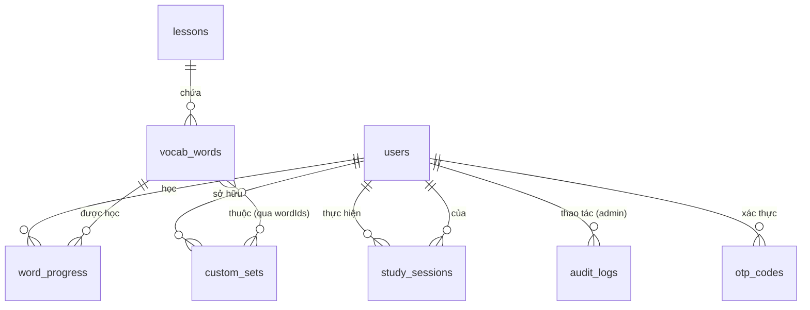

# ERD — Website luyện tiếng Nhật (Minna no Nihongo)

## 1. Thực thể

### users
| Field | Type | Ghi chú |
|-------|------|---------|
| _id | ObjectId | |
| email | String | unique, lowercase |
| passwordHash | String | BCrypt |
| name | String | tên hiển thị |
| role | String | LEARNER / ADMIN |
| plan | String | FREE / PREMIUM (default FREE) — chỉ áp dụng cho LEARNER |
| planExpiresAt | Date? | hết hạn gói; null = không thời hạn |
| emailVerified | Boolean | |
| streakDays | Number | số ngày học liên tiếp |
| lastStudyDate | Date | ngày học gần nhất (tính streak) |
| createdAt | Date | |

### otp_codes
| Field | Type | Ghi chú |
|-------|------|---------|
| _id | ObjectId | |
| email | String | index |
| codeHash | String | hash SHA-256 của mã 6 số |
| purpose | String | REGISTER / RESET_PASSWORD |
| attempts | Number | số lần nhập sai (tối đa 5) |
| expiresAt | Date | **TTL index** — tự xóa sau 5 phút |

### lessons
| Field | Type | Ghi chú |
|-------|------|---------|
| _id | ObjectId | |
| level | String | N5 / N4 |
| lessonNo | Number | 1–25 (N5), 26–50 (N4) |
| titleJa | String | vd. 第1課 |
| titleVi | String | vd. Bài 1 — Chào hỏi, giới thiệu |
| order | Number | thứ tự hiển thị |
| Unique: (level, lessonNo) | | |

### vocab_words
| Field | Type | Ghi chú |
|-------|------|---------|
| _id | ObjectId | |
| lessonId | ObjectId | ref lessons, index |
| section | String | VOCAB (từ vựng chính) / REFERENCE (từ tham khảo) / PHRASE (cụm từ) |
| kana | String | cách đọc hiragana/katakana |
| kanji | String? | null nếu từ chỉ dùng kana |
| romaji | String | |
| meaningVi | String | nghĩa tiếng Việt (đã duyệt) |
| pos | String | loại từ: danh từ / động từ nhóm 1… / tính từ-i… |
| exampleJa | String? | câu ví dụ tiếng Nhật |
| exampleVi | String? | dịch câu ví dụ |
| audioUrl | String | /audio/{audioFile}.mp3 — tên file DETERMINISTIC: `b{lessonNo:02d}-{orderInLesson:03d}.mp3` (vd. `/audio/b01-001.mp3`), khớp seed `data/seed` + script `scripts/generate-audio.py` |
| orderInLesson | Number | thứ tự trong bài |
| Index: (lessonId, orderInLesson); text index: kana, kanji, meaningVi, romaji | | |

### custom_sets
| Field | Type | Ghi chú |
|-------|------|---------|
| _id | ObjectId | |
| userId | ObjectId | ref users, index |
| name | String | tên bộ thẻ |
| description | String? | |
| wordIds | ObjectId[] | ref vocab_words (tối đa 500 từ/bộ) |
| isPublic | Boolean | default false — chỉ plan/role trong SHARING_ALLOWED_PLANS (mặc định PREMIUM, ADMIN) được bật; backend enforce |
| createdAt / updatedAt | Date | |

### word_progress — tiến trình từng từ của từng user (trái tim của SRS)
| Field | Type | Ghi chú |
|-------|------|---------|
| _id | ObjectId | |
| userId | ObjectId | index |
| wordId | ObjectId | ref vocab_words |
| status | String | NEW / LEARNING / MASTERED |
| easeFactor | Number | SM-2, khởi tạo 2.5 |
| intervalDays | Number | khoảng cách ôn hiện tại |
| repetitions | Number | số lần trả lời đúng liên tiếp |
| lapses | Number | số lần quên |
| nextReviewAt | Date | lần ôn kế tiếp |
| lastReviewedAt | Date? | |
| correctCount / wrongCount | Number | thống kê |
| Unique: (userId, wordId); Index: (userId, nextReviewAt) | | |

### study_sessions — lịch sử phiên học (items nhúng trong document)
| Field | Type | Ghi chú |
|-------|------|---------|
| _id | ObjectId | |
| userId | ObjectId | index |
| mode | String | FLASHCARD / QUIZ_JP_VI / QUIZ_VI_JP / LISTENING / TYPING / REVIEW_DUE |
| scopeType | String | LESSON / SECTION / SET / REVIEW (REVIEW = ôn tập đến hạn SM-2, gom từ nhiều bài) |
| scopeId | String | lessonId hoặc "lessonId:section" hoặc setId; với REVIEW dùng marker "due" |
| totalItems | Number | |
| correctCount | Number | |
| items | Array | [{ wordId, correct: Boolean, timeMs }] — nhúng, không tách collection |
| startedAt / finishedAt | Date | |

### audit_logs — log thao tác của admin trên nội dung
| Field | Type | Ghi chú |
|-------|------|---------|
| _id | ObjectId | |
| adminId | ObjectId | |
| action | String | CREATE_LESSON / UPDATE_WORD / IMPORT_EXCEL… |
| targetType / targetId | String | |
| diff | Object | before/after rút gọn |
| createdAt | Date | |

## 2. Sơ đồ quan hệ

## 3. Quyết định mô hình hóa
- `word_progress` tách collection riêng (không nhúng vào user) vì số lượng =
  users × từ đã chạm (~2.156 từ/user tối đa), cần index `(userId, nextReviewAt)`
  để query "từ đến hạn" nhanh.
- `study_sessions.items` nhúng trong document: mỗi phiên vài chục items, đọc
  1 query là đủ cho trang lịch sử; không cần query ngược từ item.
- `custom_sets.wordIds` là mảng ObjectId (giới hạn 500) thay vì collection trung
  gian: đủ cho nhu cầu, populate 1 query `$in`.
- OTP dùng TTL index của MongoDB — không cần cron dọn mã hết hạn.
